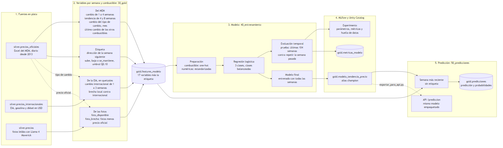

# Modelo

El caso de uso tiene dos preguntas distintas. Cada una se resuelve con el método que mejor le queda.

## Arquitectura del modelo



1. **Fuentes:** el precio oficial del MEM, el precio internacional de la EIA y los precios de las fotos, todos desde plata.
2. **Variables:** `30_gold` las junta en `gold.features_modelo`, una fila por semana y combustible. Son 17 variables: el combustible, 10 del MEM, 4 de la EIA y 2 de las fotos. La etiqueta es la dirección del precio la semana siguiente.
3. **Modelo:** `40_entrenamiento` prepara las variables, entrena una regresión logística de 3 clases y la evalúa con las últimas 104 semanas contra la línea base del enunciado.
4. **Registro:** el experimento queda en MLflow y el modelo final en Unity Catalog con el alias `champion`.
5. **Predicción:** `50_predicciones` aplica el `champion` a la semana más reciente. La API lleva el mismo modelo.

La fuente editable es [arquitectura_modelo.mmd](arquitectura_modelo.mmd). También está en [SVG](arquitectura_modelo.svg). Para regenerar la imagen: `npx -y @mermaid-js/mermaid-cli -i docs/modelo/arquitectura_modelo.mmd -o docs/modelo/arquitectura_modelo.png -b white -s 2`.

**Versión vigente:** la 4, entrenada el 2026-11-16 con MEM, EIA y fotos. Balanced accuracy de 0.564 contra 0.458 de la línea base.

## "¿Es un buen precio?"

Se responde comparando el precio del usuario contra la referencia oficial del mismo día y combustible. El resultado es la diferencia en quetzales y si cae dentro del rango normal entre estaciones.

No necesita un modelo de ML porque la referencia oficial ya existe y es exacta. Entrenar un modelo para estimar algo que el MEM publica sería agregar error sin ganar nada.

El rango normal parte del análisis de negocio: de Q0.50 a Q1.00 por galón entre estaciones. Si las fotos llegan a dar precios por estación, el rango se puede calcular con esos datos.

## "¿Va a subir o a bajar?"

Se resuelve con un modelo de clasificación. Predice si el próximo cambio de precio será una subida, una baja o si el precio se mantendrá.

**Por qué no basta una línea de tendencia.** Una línea de tendencia solo extiende hacia adelante lo que pasó antes. Si el precio viene subiendo, siempre dirá que va a seguir subiendo. Los precios de combustible suben y bajan en saltos semanales que siguen al mercado internacional y al tipo de cambio. Un modelo de ML aprende de varias señales a la vez y puede anticipar cambios de dirección.

**Por qué clasificación.** La decisión del usuario es discreta: cargar hoy o esperar. Eso responde a los objetivos O1 y O2 del análisis de negocio. Además, el modelo entrega una probabilidad, por ejemplo "es probable que baje (70 %)".

## Horizonte: ¿esperar cuánto?

El precio de referencia del MEM cambia una vez por semana. En los datos, la mayoría de los cambios caen en lunes. Entre un cambio y el siguiente el precio no se mueve.

Por eso "esperar" significa **esperar al próximo cambio de referencia**, que llega en 7 días o menos. El modelo responde: "si esperas al próximo cambio, ¿el precio será más alto, más bajo o igual que hoy?".

| Día de la consulta | Próximo cambio | Respuesta del sistema |
|---|---|---|
| Martes 10 | Lunes 16 | Dirección del cambio del lunes 16, a 6 días |
| Domingo 15 | Lunes 16 | Dirección del cambio del lunes 16, a 1 día |

La API también devuelve cuántos días faltan para el próximo cambio. Así el usuario decide si puede esperar con el combustible que tiene.

Antes de entrenar hay que confirmar con los datos qué día de la semana se toma como cambio. Si hay semanas con dos cambios o sin cambio, la semana se cuenta igual: la etiqueta compara el precio al inicio de la semana siguiente contra el precio de hoy.

**Semanas.** Van de martes a lunes, como los precios de referencia del MEM, y se identifican por su martes de inicio, como en el ejemplo de la API del enunciado. Las variables de una semana usan los datos de su cierre, el lunes. Solo se usan semanas completas: si el último dato del Excel no es lunes, esos días no forman una semana nueva. La semana completa más reciente queda sin etiqueta, porque su semana siguiente es la que el modelo tiene que predecir.

## Datos de entrenamiento

1. **Fuente:** `gold.features_modelo`. Junta las tres fuentes del pipeline: el Excel del MEM, el precio internacional de la EIA y los precios leídos de las fotos en `silver.precios`.
2. **Granularidad:** una fila por semana y combustible.
3. **Etiqueta:** dirección del cambio entre esta semana y la siguiente. Un cambio menor a Q0.10 cuenta como "se mantiene". El umbral se revisa con los datos.
4. **Variables candidatas:** cambios de las 1 a 4 semanas anteriores, tendencia de 4 y 8 semanas, cambio del tipo de cambio, régimen fiscal y mes.
5. **Variables del precio internacional,** de la EIA y convertidas a quetzales con el tipo de cambio:
   1. Cambio del precio internacional en las 3 semanas anteriores.
   2. Brecha: precio local menos internacional, comparada con su promedio de 8 semanas. Si el precio local quedó muy arriba del internacional, lo esperable es que baje.
6. **Variables de las fotos,** desde `silver.precios`:
   1. `foto_disponible`: 1 si hubo al menos una foto con precio válido de ese combustible en la semana.
   2. `foto_brecha`: precio promedio de las fotos de la semana menos el precio oficial. Es lo que cobra la gasolinera contra la referencia.
   3. Las semanas sin foto valen 0 en las dos y no se descartan. Así el modelo sigue entrenando con toda la historia del MEM.

### Efecto de las fotos (2026-11-16)

Misma partición temporal, prueba desde el 5 de noviembre de 2024. 147 de las 312 filas de prueba tienen foto.

| Variables | Balanced accuracy |
|---|---|
| MEM y EIA | 0.548 |
| MEM, EIA y fotos | 0.564 |
| Línea base del enunciado | 0.458 |

Para saber si la mejora es real o ruido se hicieron dos pruebas de Monte Carlo:

1. **Bootstrap por semanas,** 2,000 remuestreos: mejora de +0.016, con intervalo de 95 % de -0.023 a +0.054. En 81 % de los remuestreos el modelo con fotos es mejor.
2. **Prueba de permutación,** 200 corridas: se barajan las variables de fotos entre semanas y se reentrena. Solo 2 % de las corridas igualan la mejora, así que p = 0.02.

Conclusión: las fotos aportan información real, pero con tan pocas semanas la mejora es pequeña y su intervalo incluye el cero.

## Cómo se evalúa

1. **Partición temporal:** las últimas 104 semanas, unos dos años, se reservan para evaluar. Se entrena con las anteriores. Nunca partición aleatoria, porque filtraría información del futuro.
2. **Métricas reportadas:** balanced accuracy, F1 macro y acierto de la dirección en las semanas con movimiento. Se registran también para la línea base del enunciado, "se repite la dirección de la semana anterior". El enunciado pide reportar si el modelo la supera, no exige superarla.
3. **Modelo elegido:** regresión logística, porque fue el candidato más estable en la prueba de viabilidad.
4. **Modelo final:** después de evaluar, se entrena con todas las semanas que tienen etiqueta y ese es el que se registra.

**Código:** las variables están en `src/gas_price/features.py` y el modelo en `src/gas_price/modelo.py`. El notebook de oro, el de entrenamiento y `scripts/evaluar_modelo.py` usan ese mismo código. El script corre la evaluación en local con los archivos de `data/`:

```
python scripts/evaluar_modelo.py
```

Resultado con los datos al 2026-11-12, prueba desde el 11 de noviembre de 2024:

| Métrica | Modelo | Repetir la semana pasada |
|---|---|---|
| Balanced accuracy | 0.55 | 0.46 |
| F1 macro | 0.55 | 0.46 |
| Dirección correcta cuando hay movimiento | 0.74 | 0.64 |

## Prueba de viabilidad (2026-11-12)

Prueba local antes de construir el pipeline. Una fila por semana y combustible. Se entrenó con el pasado y se evaluó con los años siguientes. Como punto de comparación se usa la regla "repetir la semana pasada": si esta semana subió, decir que la próxima también sube.

| Periodo de prueba | Repetir la semana pasada | Logística, solo MEM | Logística, MEM y EIA | Gradient Boosting, MEM y EIA |
|---|---|---|---|---|
| 2020 a 2021 | 0.49 | 0.43 | 0.44 | 0.43 |
| 2022 a 2023 | 0.48 | 0.49 | 0.54 | 0.47 |
| 2024 a 2026 | 0.45 | 0.43 | 0.52 | 0.48 |

Las cifras son balanced accuracy con tres clases. Al azar daría 0.33.

**Qué significa:**

1. Con solo el Excel del MEM, los modelos no superan a la regla de repetir la semana pasada. Entrenar con menos años tampoco cambia el resultado.
2. Con el precio internacional, la regresión logística supera a esa regla desde 2022. Cuando el precio sí se mueve, acierta la dirección en 77 % de los casos, contra 70 % de la regla.
3. Las variables con más peso son la brecha contra el precio internacional y el cambio internacional de la semana anterior. Tiene sentido económico.
4. Hay cambios que ningún dato anticipa, como la baja de Q9.10 del 5 de octubre de 2026 por la exención de impuestos.
5. La regresión logística es el candidato más estable.

Las métricas se registran en MLflow para comparar versiones futuras.

## Registro

Igual que en el Ejercicio 5:

1. Experimento `/Shared/equipo-01-tendencia`, visible para todo el equipo.
2. Métricas y parámetros registrados a mano, con las etiquetas `huella_datos` y `modelo`. Si los datos de entrenamiento no cambiaron desde la última corrida del mismo modelo, la tarea termina sin entrenar. Como la etiqueta incluye el nombre del modelo, cambiar de catálogo siempre provoca un entrenamiento nuevo.
3. Modelo con firma y ejemplo de entrada, serializado con cloudpickle.
4. Registro en Unity Catalog como `equipo_01.gold.modelo_tendencia_precio`, con alias `champion` en la versión más reciente.

**Entrada del modelo:** una fila con `combustible` como texto (`super`, `regular` o `diesel`) y las variables numéricas de `gold.features_modelo`. **Salida:** `sube`, `baja` o `se_mantiene`.

## Predicciones y métricas

El job escribe dos tablas de oro:

1. **`gold.predicciones`**, escrita por la tarea `50_predicciones`. Una fila por semana y combustible: la dirección predicha para la semana siguiente, su probabilidad, la probabilidad de cada clase y la versión del modelo. Cuando llega la semana siguiente, la misma tarea completa `direccion_real` y `acierto`. Las predicciones se acumulan, así que con el tiempo muestran el acierto del modelo en semanas que no usó para entrenar. Es la evidencia de cómo le va al modelo con semanas nuevas.
2. **`gold.metricas_modelo`**, escrita por `40_entrenamiento`. Una fila por versión del modelo con sus métricas, las de la línea base y si la supera.

`semana` es el martes de inicio de la semana con los datos usados, y `semana_objetivo` el de la semana cuyo cambio se predice. Por ejemplo, con datos hasta el lunes 9 de noviembre de 2026, `semana` es el martes 3 y `semana_objetivo` el martes 10.

La lógica está en `src/gas_price/modelo.py`, en `semana_a_predecir`, `predecir` y `fila_de_metricas`, con tests.

## El modelo en la API

Acordado con el catedrático el 2026-11-13: la API carga el modelo `champion` descargado de Databricks y lo empaqueta en su imagen de Docker. Para predecir usa la semana más reciente de una copia de `gold.features_modelo`, con las columnas de `features.VARIABLES`. La salida debe coincidir con la fila de esa semana en `gold.predicciones`.

El modelo está guardado con cloudpickle. Para cargarlo hace falta la misma versión de scikit-learn con que se entrenó. El modelo descargado de MLflow trae un `requirements.txt` con esas versiones.
