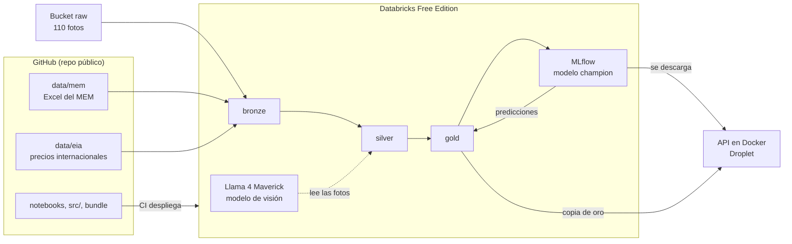

# Handoff del proyecto final: predicción del precio de la gasolina

Actualizado: 2026-11-15. Los resultados de Databricks y Docker citados abajo se midieron el 2026-11-14, salvo que se indique otra fecha. Equipo 01, MLOps, UVG.

Este documento da el contexto completo del proyecto para quien siga trabajando en él. No hace falta leerlo entero: cada sección apunta al documento del repo que tiene el detalle. También se puede pasar completo a un agente de código como contexto inicial. La sección 12 tiene instrucciones para ese caso.

Repo: <https://github.com/chuy-zip/equipo-01-gasolina-gt>. Todas las rutas de este documento son relativas a la raíz del repo.

---

## 1. Qué es el proyecto

**El enunciado oficial está en `docs/contexto/enunciado_proyecto_final.pdf`. Léanlo primero: define los nombres de las tablas, la rúbrica y los entregables. Si algo de este documento lo contradice, manda el enunciado.**

En resumen: un pipeline de punta a punta en Databricks, con arquitectura medallón, que convierte **fotos de precios** en datos y predice si el precio de cada combustible sube, baja o se mantiene la semana siguiente. La API está implementada y probada en Docker local. El equipo confirmó el 2026-11-15 que ya se desplegó en el Droplet; la respuesta pública y el origen de los artefactos no están documentados en este repo.

| Parte | Estado | Puntos en la rúbrica |
|---|---|---|
| Fotos a bronce y plata, con extracción de precios y reglas de calidad | Hecho y probado en Databricks. PR #20 y #21 integrados en `main` | 25 |
| Oro, modelo, MLflow, job programado y alertas | Hecho. Oro ya toma las filas de las fotos | 30 |
| API en el Droplet | API integrada en `main` y probada en Docker local. Despliegue confirmado por el equipo; falta documentar URL, respuesta pública y origen de los artefactos | 20 |
| Repo, informe y presentación | Parcial. Faltan diagrama, informe y presentación | 25 |

El resumen completo de cumplimiento está en `docs/plan/plan_implementacion.md`, sección "Cumplimiento del enunciado".

## 2. Estado actual

**PR integrados en `main` el 2026-11-15, según el historial local:**

| PR | Qué integró | Commit de merge |
|---|---|---|
| [#20](https://github.com/chuy-zip/equipo-01-gasolina-gt/pull/20) | Fotos a bronce | `61c69e9` |
| [#21](https://github.com/chuy-zip/equipo-01-gasolina-gt/pull/21) | Fotos a plata, reglas de calidad, revisión manual y línea base de OCR | `bd25e1c` |
| [#22](https://github.com/chuy-zip/equipo-01-gasolina-gt/pull/22) | API en FastAPI con Docker | `95af3a4` |
| [#23](https://github.com/chuy-zip/equipo-01-gasolina-gt/pull/23) | `scripts/exportar_local.py`, alternativa para generar artefactos sin Databricks | `ddcc465` |

Los merges están en el código. El repo no guarda una corrida posterior del job completo con el código de `main` ni una prueba externa del Droplet. El equipo confirmó que el despliegue ya se hizo.

Lo que ya funciona, probado en Databricks:

1. Los datos del MEM y de la EIA pasan por bronce, plata y oro, igual que antes.
2. **Las 110 fotos están en `bronze.fotos_precios`.** Una segunda carga no agrega nada.
3. **`silver.precios` tiene unos 260 precios** sacados de las fotos y `silver.precios_rejected` unos 210 rechazos con su motivo. Las 110 fotos quedaron en una de las dos tablas o en las dos.
4. **Oro ya tiene filas de fotos:** `gold.precio_semanal` tiene de 69 a 83 semanas por combustible con `fuente = fotos`.
5. El modelo, el job `equipo-01-pipeline`, la programación de los martes y la alerta por correo siguen igual.
6. **La API corre en Docker local.** Las 8 consultas de `tests/consultas_api.sh` responden 200 y la predicción coincide con `gold.predicciones` en los tres combustibles.

Las tablas de fotos se llenaron con corridas de desarrollo del código de los PR #20 y #21. Una segunda carga de bronce no agregó fotos y una segunda extracción de plata no reprocesó las ya tratadas. Falta documentar una corrida completa del job con el código integrado en `main`.

**Números de referencia, al 2026-11-14:**

| Qué | Valor |
|---|---|
| Fotos en bronce | 110 de 110 |
| Precios válidos de fotos en plata | Unos 260 |
| Exactitud anterior a la revisión actual: 20 fotos y 31 precios | 21 a 22 de 31, cerca de 70 %. Falta recalcular con el CSV revisado por Nelson el 2026-11-15 |
| Exactitud del OCR como línea base, mismas fotos | 3 de 31, 10 % |
| Balanced accuracy del modelo, últimos 2 años | 0.55, contra 0.46 de la línea base del enunciado |
| Modelo en la API | Versión 3 |
| Predicción de la semana del 2026-11-10 | Baja en los tres combustibles, con 92 a 94 % de probabilidad |
| Referencia vigente | Súper Q32.49, Regular Q29.98, Diésel Q41.01, del 2026-11-10 |

## 3. Arquitectura

Decisiones vigentes:

1. **Cada capa vive en su bucket de S3**, como tablas externas de Unity Catalog dentro del prefijo `equipo-01/`.
2. **Las fotos se leen con un modelo de visión**, Llama 4 Maverick, que ya sirve el workspace. Es gratis dentro de la cuota de Free Edition y las fotos no salen de Databricks. El OCR queda como línea base. Ver la sección 7.
3. **La API no lee S3.** El Droplet no tiene acceso. La prueba documentada en Docker local usó el modelo `champion` y una copia de oro descargados con `scripts/exportar_para_api.py`. El equipo confirmó que la imagen ya se desplegó en el Droplet, pero aún no documentó qué exportador generó los artefactos de esa imagen.

Detalle: `docs/arquitectura/arquitectura.md` y `docs/datos/esquemas_medallion.md`.

## 4. Mapa del repo y de la documentación

| Ruta | Qué hay |
|---|---|
| `README.md` | Resumen, uso local y cómo actualizar los datos |
| `databricks.yml` | Definición del bundle: destino, variables, permisos y archivos excluidos |
| `resources/pipeline.yml`, `resources/setup.yml`, `resources/exploracion.yml` | Los tres jobs. Exploración ahora incluye la línea base de OCR |
| `databricks/notebooks/` | Un notebook por tarea. `10` fotos a bronce, `21` fotos a plata, `25` línea base de OCR |
| `src/gas_price/` | Código compartido. `fotos.py` tiene las reglas de las fotos: lectura del modelo, reglas de calidad y exactitud |
| `data/revision_manual/revision_fotos.csv` | Revisión manual: precio real de cada combustible en 20 fotos |
| `api/` | La API: `app/`, `Dockerfile`, `docker-compose.yml`, `requirements.txt`, `.env.example` y su README |
| `tests/` | Tests del paquete, de la API y `consultas_api.sh` con las pruebas de usuario final |
| `scripts/exportar_para_api.py` | Descarga el modelo `champion` y la copia de oro a `api/artefactos/` |
| `scripts/exportar_local.py` | Genera artefactos para la misma carpeta desde `data/`, con un modelo entrenado en local y sin precios de fotos. El manifiesto indica `origen: local` |
| `databricks/sql/tablas.sql` | Columnas y tipos de todas las tablas |
| `.github/workflows/` | `bundle-plan.yml`, `tests.yml` y `bundle-deploy.yml` |
| `docs/` | Documentación. Empezar por `docs/README.md` |

| Documento | Para qué leerlo |
|---|---|
| `docs/plan/plan_implementacion.md` | Decisiones, tareas con responsable y bitácora |
| `docs/datos/fuentes_de_datos.md` | Fuentes, ciclo semanal y **"Técnica elegida"**: cómo se leen las fotos, reglas de calidad y comparación con OCR |
| `docs/datos/esquemas_medallion.md` | Columnas de cada tabla |
| `docs/modelo/modelo.md` | Modelo, variables y evaluación |
| `docs/infraestructura/databricks.md` | Workspace, límites, permisos y lecciones aprendidas |
| `docs/infraestructura/ci_cd.md` | Bundles, workflows y secretos |
| `api/README.md` | Endpoints, por qué Docker, cómo desplegar y cómo actualizar |

## 5. Cómo se trabaja

**Configuración, una vez por persona:**

1. Ser colaborador del repo en GitHub, con permiso de escritura.
2. **Permisos en Databricks:** el dueño del catálogo `equipo_01` tiene que dar `USE CATALOG` y permisos sobre los esquemas. Sin eso, cualquier lectura falla con `INSUFFICIENT_PERMISSIONS`. El comando está en la sección 11.
3. En Databricks: **Settings**, **Linked accounts**, **Add Git credential**, GitHub. Después **Create**, **Git folder**, con la URL del repo.
4. Para trabajar en local: Python 3.11 o más reciente y `pip install -e ".[test,exportar]"` en un entorno virtual.
5. Para correr cosas en Databricks desde la computadora: la CLI de Databricks y `databricks auth login --host <url_del_workspace> --profile DEFAULT`. En Windows sin `winget`, se descarga el zip de la última versión desde los releases de `databricks/cli` en GitHub.

**Dónde se edita cada cosa:**

| Qué | Dónde |
|---|---|
| Notebooks | En la carpeta Git de Databricks, o en local y se prueban con corridas de desarrollo. Ver abajo |
| `src/`, tests, scripts, API, YAML del bundle, workflows y docs | En la computadora, con git |

**Corridas de desarrollo sin desplegar.** Así se probaron los notebooks 10, 21 y 25:

1. Subir los notebooks y `src/` a una carpeta propia: `databricks workspace import-dir databricks/notebooks /Workspace/Users/<tu_usuario>/equipo01-dev/databricks/notebooks --overwrite`, y lo mismo con `src`.
2. Correr un notebook como corrida única: `databricks jobs submit --json @archivo.json`, con un `notebook_task` que apunte a esa carpeta y sus `base_parameters`.
3. Esto no es `bundle deploy`: no toca los jobs compartidos.

**Ciclo de un cambio:** rama, cambio y prueba, PR a `main`, esperar los checks `plan` y `tests`, merge. El CI despliega y corre `equipo-01-setup`. Si cambió una tabla, el paso manual de la sección 9. Después, correr `equipo-01-pipeline`.

**Reglas importantes:**

1. **Solo el CI despliega.** No usar el botón de despliegue de Databricks ni `databricks bundle deploy`.
2. **No hay esquemas por persona.** Coordinar quién toca qué tabla.
3. **Free Edition permite máximo 5 tareas de job a la vez** y tiene una cuota diaria de cómputo.
4. **El repo es público.** No subir coordenadas GPS exactas, URL completas de buckets, tokens ni exportaciones de corridas.

## 6. Bundles y CI/CD

Sin cambios desde el handoff anterior. Detalle en `docs/infraestructura/ci_cd.md`.

**Parámetros nuevos del job `equipo-01-pipeline`:**

| Parámetro | Valor por defecto | Para qué |
|---|---|---|
| `ubicacion_fotos` | `xloc-raw` | External location de donde se leen las fotos |
| `carpeta_fotos` | Vacío, la raíz | Carpeta dentro de esa ubicación. **Pendiente de confirmar con el catedrático si las fotos nuevas llegan a `fotos/AAAA-MM-DD/`.** Si es así, solo se cambia este valor |
| `modelo_vision` | `databricks-llama-4-maverick` | Endpoint que lee las fotos |
| `reprocesar_fotos` | `false` | `true` vuelve a leer todas las fotos, por ejemplo si cambia el modelo |

**Cuidado con el token de GitHub:** un token sin el permiso `workflow` no puede subir cambios a `.github/workflows/`. El push se rechaza. Por eso las dependencias de los tests de la API se pusieron en el extra `test` de `pyproject.toml`, que el CI ya instala.

## 7. Los datos

| Fuente | Qué trae | Cómo se actualiza |
|---|---|---|
| Excel del MEM, `data/mem/` | Precio oficial diario y tipo de cambio, desde 2013 | A mano |
| EIA, `data/eia/` | Precio internacional diario de gasolina y diésel | `python scripts/actualizar_eia.py` |
| Fotos, bucket raw | 110 fotos de dispensadores, de 2022 a 2026 | Las deja el catedrático. Solo lectura |

**Ciclo semanal:** cada lunes, actualizar el Excel y la EIA, PR, merge y correr el job. El martes, después del job, actualizar la API. Ver la sección 10.

**Cómo se leen las fotos.** Detalle en `docs/datos/fuentes_de_datos.md`, sección "Técnica elegida":

1. Casi todas las fotos son de un dispensador con una pantalla grande, que muestra venta y galones, y cuatro ventanas pequeñas con el precio de Diesel, Regular, Super y V-Power.
2. Llama 4 Maverick recibe la foto completa y un acercamiento a las ventanas. Devuelve JSON.
3. **Venta entre galones** da el precio exacto del combustible que se cargó y dice a qué ventana corresponde.
4. La fecha sale del EXIF. La ubicación es el municipio y el departamento más cercanos al GPS. No se guardan coordenadas.
5. **9 motivos de rechazo**, entre ellos los 3 del enunciado: precio fuera de Q20 a Q55, combustible fuera del catálogo y fecha futura. También rechaza precios a más de 15 % de la referencia del MEM, V-Power, lecturas fallidas y llaves duplicadas.
6. Solo se procesan fotos nuevas. Una segunda corrida no hace nada.

**Comparación de técnicas, mismas 20 fotos:**

| Técnica | Correctos |
|---|---|
| Llama 4 Maverick | Cerca de 70 % |
| RapidOCR con modelos PP-OCRv5 | 10 % |
| Gemma 3 12B | Peor que Maverick en la prueba de 10 fotos |

PaddleOCR no corre en serverless. Qwen 3.5 del workspace no acepta imágenes.

## 8. Tablas y modelo

Igual que antes, con las tablas de fotos ya llenas:

| Tabla | Contenido |
|---|---|
| `bronze.fotos_precios` | Las 110 fotos con su contenido y las columnas de auditoría |
| `silver.precios` | Precios válidos de las fotos. Llave: fecha, ubicación, combustible y modalidad. La modalidad es `no_indicada` porque las fotos no la muestran |
| `silver.precios_rejected` | Lo que falló, con el motivo |
| `gold.precio_semanal` | Ahora con filas de `fuente = fotos` además de `mem` |

El resto de tablas y el modelo no cambiaron. Ver el handoff anterior o `docs/datos/esquemas_medallion.md` y `docs/modelo/modelo.md`.

## 9. Cómo agregar o cambiar una tarea del pipeline

Sin cambios. Detalle en `docs/datos/esquemas_medallion.md`, sección "Cómo cambiar una tabla".

## 10. Lo que falta

| Tema | Estado | Notas |
|---|---|---|
| **Corrida completa con el código de `main`** | Sin evidencia en el repo | Confirmar que `equipo-01-pipeline` pasa después de los merges |
| **Evidencia del despliegue de la API en el Droplet** | Despliegue confirmado por el equipo; evidencia pendiente | Registrar URL, respuesta pública e imagen usada. Pasos de verificación en `api/README.md` |
| **Recalcular la exactitud de la extracción** | Pendiente | Nelson revisó las 20 fotos y actualizó `data/revision_manual/revision_fotos.csv` el 2026-11-15. Volver a ejecutar `21_silver_imagenes` para obtener la métrica actualizada |
| **Evidencia de 2 corridas con fotos de semanas distintas** | No documentada | Las repeticiones de desarrollo con 0 fotos nuevas no la prueban. Se necesitan dos ejecuciones exitosas del Job, cada una con fotos nuevas de una semana distinta, y capturas del historial y de la duración de cada tarea |
| **Ubicación de las fotos nuevas** | Pendiente de confirmar | Solo hay que cambiar el parámetro `carpeta_fotos` |
| **Diagrama exportado, informe y presentación** | Por hacer | El informe puede usar la comparación de técnicas y las métricas de este documento |

**Despliegue y actualización de la API en el Droplet.** Lo acordado con el catedrático:

El PR #23 agregó `scripts/exportar_local.py` para generar el modelo y las tablas desde `data/` cuando no se usa Databricks. Ese script no incluye los precios de fotos en la copia de oro y asigna `version_modelo: local`. La prueba local registrada antes del PR #23 usó el `champion` de Databricks. El equipo confirmó el despliegue, pero aún no consta qué origen tienen los artefactos de la imagen instalada. El archivo `api/artefactos/manifiesto.json`, generado al exportar y excluido de Git, permite distinguirlos: el local lleva `origen: local` y `version_modelo: local`; el de Databricks lleva el nombre registrado del modelo, la versión, `workspace` y `run_id`. `/health` muestra la versión, pero no el campo `origen`.

1. Exportar: `python scripts/exportar_para_api.py --perfil DEFAULT`. Verifica que el modelo descargado prediga lo mismo que Databricks.
2. Construir en local: `cd api` y `docker build -t equipo-01-gasolina-api:latest .`
3. Subir la imagen: `docker save equipo-01-gasolina-api:latest | gzip | ssh -i <llave> equipo-01@<ip> "gunzip | docker load"`.
4. Copiar `docker-compose.yml` a `/home/equipo-01/api/`, crear ahí un `.env` con `PUERTO=8001` y permisos 600, y correr `docker compose up -d`.
5. Probar desde afuera: `bash tests/consultas_api.sh http://<ip>:8001`.
6. Cada semana, después del job del martes: repetir los pasos 1 a 4. `/health` muestra la fecha de la copia de oro.

No instalar paquetes del sistema ni reiniciar el Droplet sin autorización del catedrático. Solo usar el usuario, la carpeta y el puerto del equipo.

## 11. Lecciones aprendidas y trampas conocidas

Las del handoff anterior siguen vigentes. Nuevas:

1. **Permisos del catálogo.** Una persona nueva no puede leer nada hasta que el dueño corra `GRANT ALL PRIVILEGES ON CATALOG equipo_01 TO \`<correo>\`` en el SQL Editor.
2. **El cómputo serverless es ARM.** PaddleOCR se cae con `SIGSEGV`. RapidOCR corre los mismos modelos sobre ONNX y sí funciona.
3. **`%pip` puede romper Spark.** Si una librería cambia `numpy` a la versión 2, falla pandas. Si cambia dependencias de Spark Connect, `spark` deja de funcionar. Solución: fijar `numpy<2` y leer con Spark antes del `%pip`, como hace el notebook 25.
4. **La primera celda de un notebook no puede ser `%pip`** en una corrida de job: falla con "spark should be initialized with the first notebook command". Poner antes una celda de markdown o de código.
5. **Git Bash en Windows cambia las rutas** que empiezan con `/`, como `/Workspace/...`. Usar `MSYS_NO_PATHCONV=1` antes de los comandos de la CLI de Databricks.
6. **Pantallas de 7 segmentos:** el modelo confunde 9 con 4. El emparejamiento de venta entre galones lo tolera.
7. **Versión de scikit-learn:** el modelo se entrenó con `scikit-learn==1.7.2`. La imagen de la API usa esa versión. En local con otra versión salen avisos y puede fallar.
8. **pytest en Windows** puede fallar con `PermissionError` en la carpeta temporal. Usar `--basetemp` con otra carpeta.
9. **SQL desde la computadora:** el workspace tiene el "Serverless Starter Warehouse". `exportar_para_api.py` lo usa solo.

## 12. Si le pasas este documento a un agente

Pégale esto junto con el documento:

> Estás ayudando en un proyecto de MLOps en Databricks Free Edition. El repo es <https://github.com/chuy-zip/equipo-01-gasolina-gt>. Antes de proponer cambios, lee `README.md`, `docs/plan/plan_implementacion.md` y el documento de `docs/` relacionado con la tarea. Respeta estas reglas:
> 1. Responde en español.
> 2. En documentos y notebooks: sin guiones largos ni flechas, oraciones cortas, sin muchas comas y lenguaje comprensible.
> 3. La documentación va en `docs/`, en la subcarpeta que corresponda, y no referencia archivos fuera del repo.
> 4. La lógica va en `src/gas_price/` con tests. Los notebooks solo leen y escriben con Spark.
> 5. Solo el CI despliega. No corras `databricks bundle deploy` ni uses el botón de despliegue de Databricks. Para probar, usa corridas de desarrollo con `databricks jobs submit` desde una carpeta propia.
> 6. No subas coordenadas GPS exactas, URL completas de buckets ni tokens: el repo es público.
> 7. Investiga en la documentación oficial en lugar de responder de memoria, y cita la fuente.
> 8. Si una decisión no está clara, pregunta antes de decidir. No agregues ideas al plan sin confirmarlas con el equipo.
